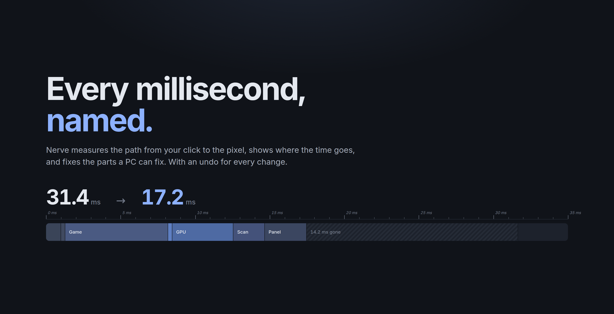
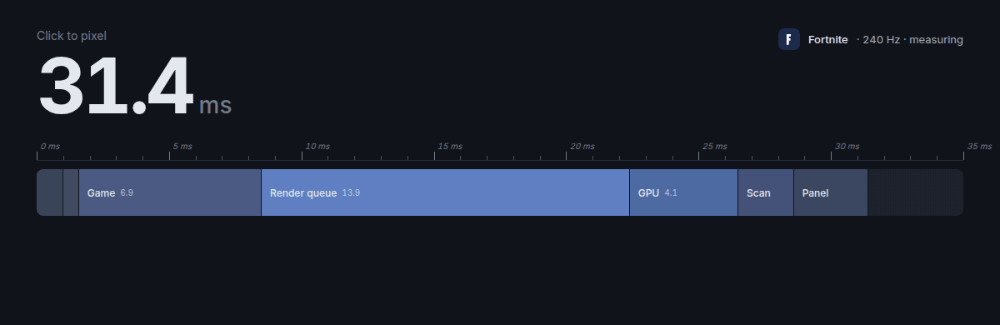
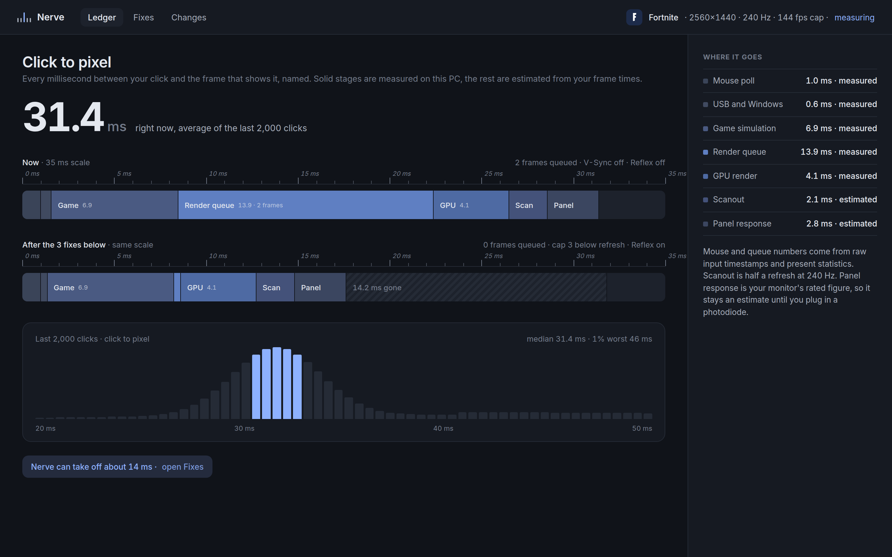
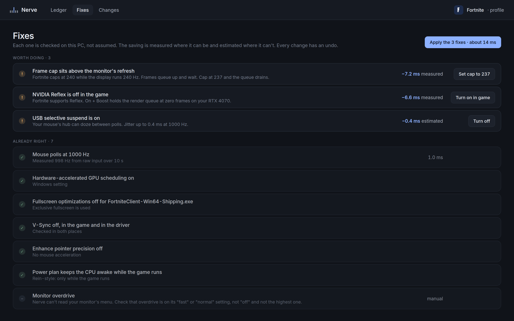
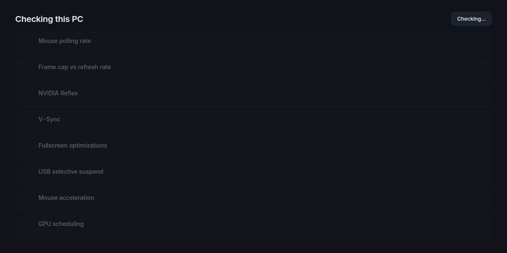
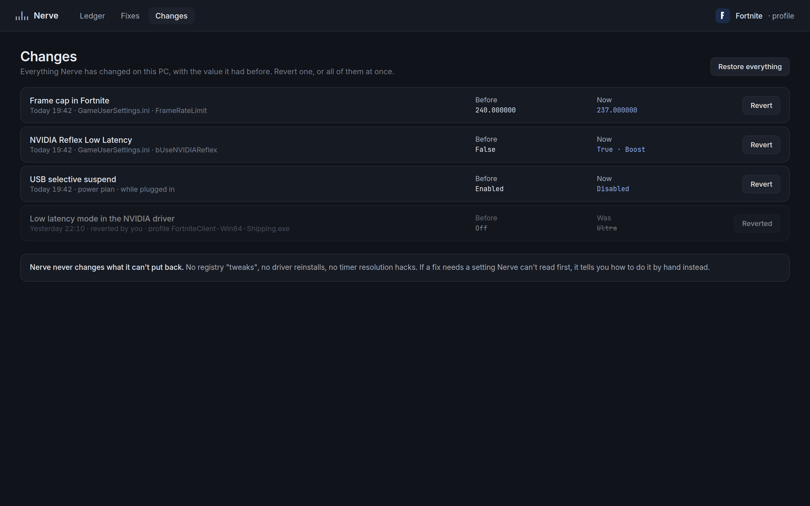

# Nerve — input lag fixer that measures click-to-pixel latency

  
  
  
  

<h2 align="center">Nerve</h2>

<b>An input lag fixer that measures first. Nerve shows every millisecond between your click and the pixel, fixes the parts a PC can fix, and keeps an undo for each change.</b>

<b>Free · Windows 10 and 11 · open source.</b> <b>v1.2.6 is out now</b> — grab it from <a href="releases/latest">Releases</a>.

## See it work

Three fixes, applied one at a time, each with its own price. The ruler never changes scale, so what you see shrink is real time coming off the path.

## What Nerve will do

- Measures the path from your click to the pixel and splits it into stages: mouse poll, OS, game simulation, render queue, GPU, scanout, panel.
- Labels every stage as measured on this PC or estimated, and shows a histogram of the last 2,000 clicks.
- Checks the settings that actually matter: frame cap vs refresh rate, NVIDIA Reflex, V-Sync, fullscreen optimizations, USB selective suspend, mouse polling rate, mouse acceleration.
- Prices each fix in milliseconds before you apply it, and shows the ledger after the fixes on the same scale.
- Logs every change with the value it had before, with Revert per change and Restore everything.
- Does no registry hacks, driver reinstalls or timer tricks, and never changes a setting it cannot read first.

## Why this one

Most "latency optimizers" apply a list of registry tweaks and call it a day. You never learn what changed or whether it helped. Nerve starts from a number you can see move.

- **A ledger, not a guess.** Mouse poll, OS, game simulation, render queue, GPU, scanout, panel. Each stage is labelled measured or estimated.
- **Fixes with a price tag.** Every fix says how many milliseconds it is worth on your PC, before you apply it.
- **Undo for everything.** Nerve records the old value of every setting it touches. Revert one, or all of them.

## Screens

### Ledger

Two rulers on the same scale: now, and after the fixes Nerve found. The side panel says where each number comes from. Measured stages use raw input timestamps and present statistics. Scanout and panel response stay estimates until you plug in a photodiode.

### Fixes

Each check runs on your machine, not from a list. The frame cap one alone is most of the win for many people: cap just under the refresh rate and the render queue drains.

A scan takes a few seconds and ends in a short list. Most of it will already be right, and Nerve says so instead of inventing work.

### Changes

The whole history. Nerve never touches a setting it can't read first, and it won't do registry tweaks, driver reinstalls or timer hacks. When a fix needs your monitor's menu, it tells you what to press.

## How the numbers are made

| Stage | Source |
| --- | --- |
| Mouse poll | Interval between raw input events over 10 s |
| USB and Windows | Raw input timestamp to the game's input read |
| Game simulation | Frame time from present statistics |
| Render queue | Frames in flight × frame time, from present statistics |
| GPU | GPU busy time per frame |
| Scanout | Half a refresh period, estimated |
| Panel response | Monitor's rated figure, estimated |

End-to-end hardware measurement (a photodiode on the screen) is on the roadmap as an optional accessory. Until then the total is labelled as a mix of measured and estimated, never as a lab number.

## FAQ

**Is 14 ms a promise?**
No. It is the sample PC in these mockups. Your numbers come from your own mouse, game, GPU and monitor, and Nerve shows them before you change anything.

**How can software measure input lag without hardware?**
It can't measure all of it. Nerve measures the mouse, the OS, the game and the render queue, estimates scanout and panel response, and labels which is which.

**Will this get me banned?**
Nerve reads timings Windows already exposes and edits settings you could change by hand. It does not hook into the game.

**What if a fix makes things worse?**
Open Changes and press Revert. The old value is stored for every change.

## Get it

Download [`input-lag-reducer.zip`](releases/latest) — v1.2.6, Windows 10 and 11. Unpack the folder and start `Nerve.exe`.

## Roadmap

- [x] Brand, icon and screens
- [ ] Raw input and present statistics collectors
- [ ] Ledger with measured and estimated labels
- [ ] Checks with per-PC savings
- [ ] Change log with revert
- [ ] Photodiode mode for true click-to-photon

## Credits

Screens show the Fortnite mark (Epic Games) and NVIDIA's name to illustrate a real game profile. These belong to their owners and are not part of this project. The design scripts fetch marks from Simple Icons at render time; none are stored in the repo. Nerve's own code, brand and screens are [MIT](LICENSE).

## About this repo

**Description:** Input lag fixer that measures first: click-to-pixel latency ledger per stage, fixes priced in milliseconds, undo for every change. No registry hacks.

**Topics:** input-lag, input-latency, latency, nvidia-reflex, mouse-latency, gaming-performance, frame-time, windows
